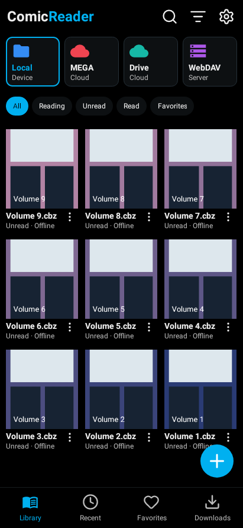
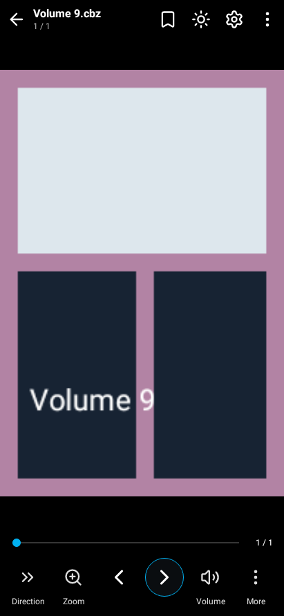
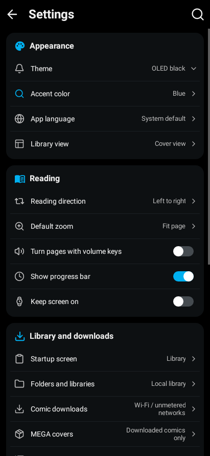

<div align="center">
  
  <h1>ComicReader</h1>
  <p>An open-source comic reader for Android phones and tablets.<br>Read offline, connect your cloud library, and pick up where you left off.</p>
  <p>
    <a href="https://github.com/Poiki/ComicReader/releases/latest"></a>
    
    <a href="LICENSE"></a>
  </p>
  <p><a href="#install">Install</a> · <a href="docs/README.md">Documentation</a> · <a href="CONTRIBUTING.md">Contribute</a> · <a href="https://github.com/Poiki/ComicReader/releases">Release notes</a></p>
</div>

## A look inside

| Library | Reader | Settings |
| :---: | :---: | :---: |
|  |  |  |

Native UI renders with project-generated sample comics. Light, dark and OLED themes are available.

## Features

| | |
| --- | --- |
| **Your library** | CBZ, ZIP, CBR, RAR and PDF. Cover or list view, favorites, reading filters and pull-to-refresh. |
| **Cloud access** | Direct MEGA login, Google Drive and HTTPS WebDAV. Download comics for offline reading. |
| **Reader controls** | Pinch and double-tap zoom, page fit, manga direction, bookmarks, brightness and volume-key navigation. |
| **Keep reading** | Saved progress, an optional resume-on-launch screen and the next unread issue in the same numbered series and folder. |
| **Home-screen widgets** | Continue reading, Reading & next, and Reading shelf. Unfinished comics come first; resize to show more covers and progress. |
| **Make it yours** | Light, dark and OLED themes, three accent colors, and English or Spanish. |
| **Background work** | Cached covers, network and battery constraints, and separate mobile-data preferences for covers and comic downloads. |
| **Progress sync** | Optional sync through one selected provider, plus progress export and import. Comic files are not synced. |

## Install

Download an APK from the [latest release](https://github.com/Poiki/ComicReader/releases/latest). Requires **Android 9 or later** and a supported processor:

| APK | Choose this for |
| --- | --- |
| [ARM64](https://github.com/Poiki/ComicReader/releases/latest/download/ComicReader-arm64-v8a.apk) | Android phones and tablets with an ARM64 processor. |
| [x86_64](https://github.com/Poiki/ComicReader/releases/latest/download/ComicReader-x86_64.apk) | x86_64 devices and emulators. |
| [Universal](https://github.com/Poiki/ComicReader/releases/latest/download/ComicReader-universal.apk) | Both supported architectures in one larger APK, if you are unsure which to choose. |

The universal APK includes ARM64 and x86_64; 32-bit processors are not supported. Each release includes `SHA256SUMS`.

Install over your existing version to keep your library, accounts and progress. The app checks GitHub Releases on each foreground open; Android asks you to confirm installation. You can also use **Settings → App updates → Check now**.

Releases currently use the original test signing certificate. Android or Play Protect may reject installation; see [signing and update verification](docs/updates.md) and [test results](docs/testing.md).

## Start reading

1. Tap **+** to import local files, or connect a cloud provider. For MEGA, sign in, open a folder and select **OK** to save it as your library.
2. Tap a comic to open it. Remote comics download before reading; comic downloads and cover preparation default to Wi-Fi/unmetered networks.
3. Tap the page edges to turn, or the center to show controls. After the final page, turn forward once more to finish the comic and open the next clear unread number in that series and folder.

Add widgets from your launcher's widget picker under **ComicReader**. Larger sizes show up to nine comics. Widgets use cached listings and covers; tapping a remote comic downloads it when needed. Open the app to refresh cloud folder contents.

MEGA works with the bundled SDK. Google Drive requires your own OAuth registration and compatible Google Play services. See [cloud setup](docs/cloud-setup.md) and [progress synchronization](docs/synchronization.md).

The [F-Droid variant](docs/fdroid.md) excludes Google Play Services and Google Drive. Local reading, MEGA and WebDAV remain available. Listing text is provided in English and Spanish; official repository inclusion is still pending.

[Download the Google-free ARM64 build](https://github.com/Poiki/ComicReader/releases/latest/download/ComicReader-fdroid-arm64-v8a.apk) or use its universal APK from the release page.

## Build and contribute

Use **JDK 21**, Android SDK **platform 37**, Build Tools **36.0.0**, and Docker with its Linux engine. Set `JAVA_HOME` and `ANDROID_HOME`. Toolchain and dependency versions are pinned.

```powershell
# First build: compile the official MEGA SDK into the local cache.
.\scripts\build-mega-native.ps1
.\scripts\build-archive-native.ps1

.\gradlew.bat :app:testDebugUnitTest :app:assembleDebug :app:lintDebug
```

Debug APKs are written to `app/build/outputs/apk/debug/`. Release builds use R8 and are signed separately.

Read the [build guide](docs/building.md), [architecture](docs/architecture.md) and [contribution guide](CONTRIBUTING.md) before changing behavior. [Testing](docs/testing.md) records what has been verified and what still needs device testing.

Google Play and F-Droid distribution are under review. See [store readiness](docs/store-readiness.md) for the requirements and current blockers.

## Current limits

7z, continuous scrolling and double-page spreads are not implemented. Battery life and performance have not been benchmarked on physical hardware. Local comic copies and cached covers have no additional content encryption. Concurrent offline progress conflicts are resolved per comic.

<details>
<summary>Archive and image limits</summary>

Maximums: 1 GiB per comic, 10,000 pages, 64 MiB per archive image and 3 megapixels per decoded bitmap. RAR archives must be single-volume and unencrypted, with a dictionary of at most 64 MiB and total unpacked data of at most 4 GiB. Backward seeks in solid RAR archives can take longer.

</details>

## Support development

[](https://ko-fi.com/A0A71AC06Z)

Donations help fund development and are optional. You can also contribute fixes, translations and reproducible bug reports through the [contribution guide](CONTRIBUTING.md).

## License

Original project code and documentation are [MIT licensed](LICENSE). The embedded RAR decoder uses libarchive with its BSD licenses; the standard build also includes Google's authorization SDK under its own terms. See [third-party notices](THIRD_PARTY_NOTICES.md).
